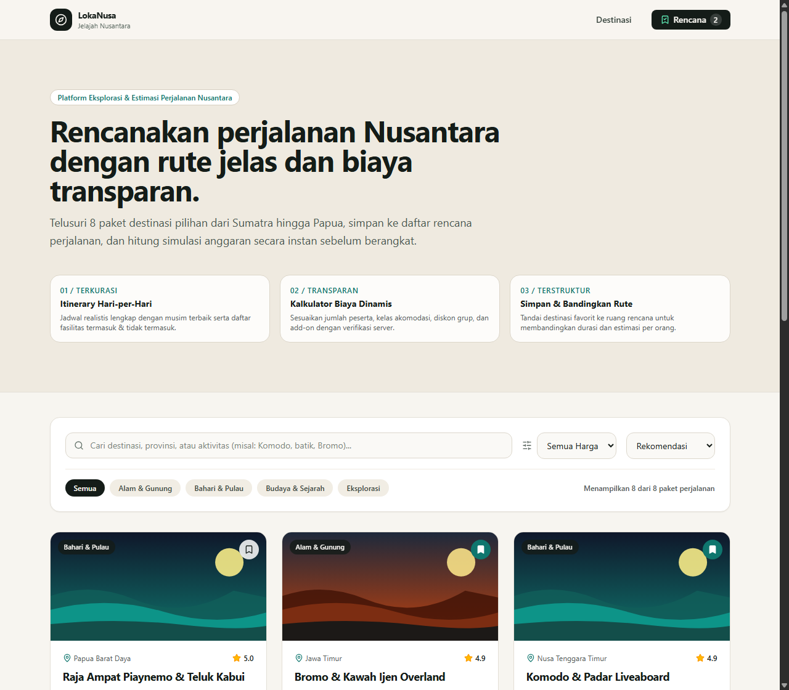
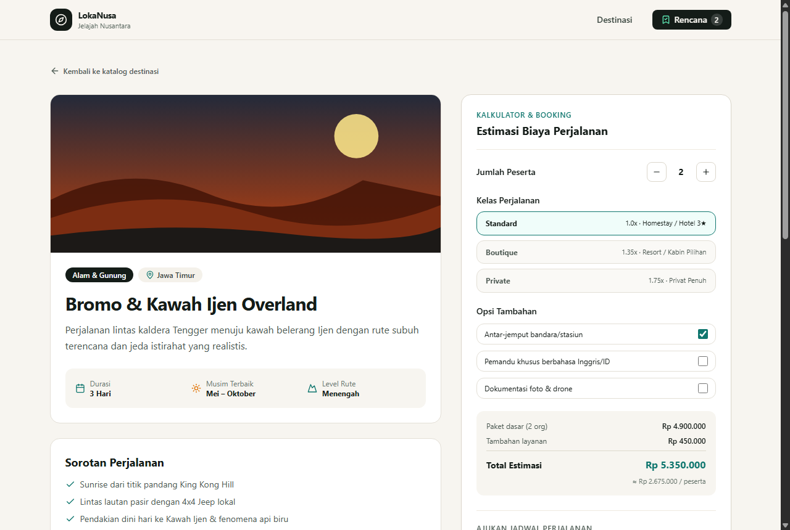
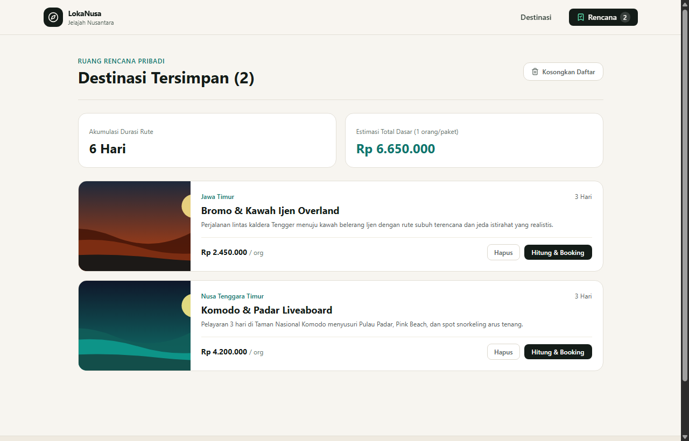

# LokaNusa — Indonesian Travel & Itinerary Planner

A modern, full-stack Next.js application for discovering Indonesian travel packages, comparing routes in a saved itinerary workspace, and calculating dynamic trip budgets with server-verified booking requests.

> Rebuilt from the ground up with Next.js 15, React 19, TypeScript, and Tailwind CSS v4.

## Preview

| Destination Explorer (`/`) | Estimator & Booking (`/destinasi/[slug]`) |
| :---: | :---: |
|  |  |

<p align="center">
  <strong>Saved Itinerary Workspace (<code>/rencana</code>)</strong><br />
  
</p>

## Features

- **Destination Explorer (`/`)**: Real-time search across regions, highlights, and provinces; category pills (`Alam & Gunung`, `Bahari & Pulau`, `Budaya & Sejarah`, `Eksplorasi`); budget ceiling filter; and multi-mode sorting.
- **Destination Detail & Smart Estimator (`/destinasi/[slug]`)**: Day-by-day itinerary breakdown, transparent inclusion/exclusion lists, best travel season, and an interactive pricing calculator supporting traveler counts, group discounts (5% for 4+, 10% for 8+), accommodation tiers (`Standard`, `Boutique`, `Private`), and optional add-ons.
- **Saved Itinerary Workspace (`/rencana`)**: Persistent `localStorage`-backed comparison board showing combined trip days and baseline cost estimates.
- **Typed REST API (`/api/destinations`, `/api/bookings`)**: Server-side input validation (departure date, traveler bounds, Indonesian phone format) and server-side price recalculation.

## Tech Stack

- **Framework**: Next.js 15 (App Router) & React 19
- **Language**: TypeScript 5
- **Styling**: Tailwind CSS v4 & Lucide Icons
- **Testing**: Node.js native test runner (`node:test`) with TypeScript type-stripping

## Local Development

```bash
npm install
npm run dev
```

Verify types, unit tests, and production build:

```bash
npm run check
```
